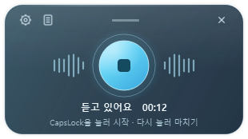

# Sori 사용 안내

Windows를 우선으로 만든 로컬 음성 입력 프로그램입니다. Qwen3-ASR-0.6B를 사용해 한국어를 받아쓰고, 입력창·클립보드·시간이 포함된 일별 기록에 남깁니다.

## Windows 실행

1. 기존 소리가 실행 중이면 트레이 메뉴에서 종료한 뒤 **`dist/Sori-Setup-0.2.0.exe`**를 실행합니다. 사용자 계정의 `%LOCALAPPDATA%\Programs\Sori`에 설치합니다. 바탕화면 바로가기와 로그인 시 자동 실행은 설치 중 선택할 수 있습니다.
2. 이후에는 **시작 메뉴의 Sori**를 실행합니다. **Python·uv의 별도 설치나 배치 스크립트 실행이 필요 없습니다.** 모델이 준비된 PC에서는 트레이에서 대기합니다. 기록·설정은 트레이 메뉴 또는 시작 메뉴의 **Sori Records and Settings**로 엽니다. 다시 실행해도 기존 프로그램으로 연결합니다.
3. 처음 사용하는 PC에서는 기록 화면의 **모델 준비하기**를 누릅니다. 최초에 `Qwen/Qwen3-ASR-0.6B-hf` 모델을 다운로드합니다. 이미 모델을 받은 PC에서는 실행 시 캐시를 자동으로 불러오고, 완료되면 바로 받아쓸 수 있습니다. 모델 파일과 실행 메모리는 수 GB가 필요합니다.
4. 입력창에 커서를 두고 **CapsLock**을 누릅니다. 작은 패널이 나타나고 말하는 도중에도 중간 인식 결과가 입력됩니다. CapsLock을 다시 누르면 남은 문장을 확정하고 패널이 자연스럽게 사라집니다. 길게 누르기 방식도 설정할 수 있습니다.

설치 없이 실행하려면 **`dist/Sori-Windows-x64.zip`** 전체를 풀고 **Sori.exe**를 실행합니다. `Sori.exe`와 `_internal` 폴더는 함께 두어야 합니다. 기존 배포 폴더와 새 배포 폴더는 구분해 두고, 기존 실행을 종료한 뒤 새 파일을 실행하세요.

배포본은 Windows x64 CPU용입니다. Python 실행 환경이 앱 안에 들어 있습니다. 기존 `%LOCALAPPDATA%\Sori`의 모델·설정·기록을 그대로 사용하므로 다시 다운로드하거나 기록을 옮길 필요 없습니다. 개발용 소스 ZIP과 실행용 ZIP은 별도입니다.

**설정 → 마이크 테스트 · 5초**로 실제 입력 여부와 음량을 확인합니다. 테스트는 모델 없이 마이크만 열고 음성을 저장하지 않습니다. 녹음 중에는 패널의 마이크가 중단 버튼으로 바뀌고, 테두리가 움직이며, 실제 입력 음량에 따라 파형이 반응합니다. 무음 또는 입력 데이터가 없으면 상태 문구로 알려줍니다.

Windows에서 마이크를 허용하려면 **설정 → 개인정보 및 보안 → 마이크 → 데스크톱 앱에서 마이크에 액세스하도록 허용**을 켭니다. 앱 설정의 **마이크 권한**으로 해당 화면을 열 수 있습니다. Microsoft의 [마이크 권한 안내](https://support.microsoft.com/en-us/windows/privacy/turn-on-app-permissions-for-your-microphone-in-windows)에 따르면 데스크톱 앱은 개별 허용 스위치가 없을 수 있습니다. 실행 파일의 앱 이름·아이콘·Windows 앱 ID는 Sori로 지정했지만 OS 권한을 자동으로 부여하지 않습니다.

기본 키는 누르기 쉬운 **CapsLock 하나**입니다. Windows에서는 앱 실행 중 지정한 단일 키를 음성 입력 전용으로 사용하고 원래 키 동작을 차단합니다. 따라서 CapsLock을 눌러 받아쓰기를 시작해도 대문자 전환은 일어나지 않습니다. 앱을 종료하거나 다른 키로 지정하면 원래 키 기능을 사용할 수 있습니다.

**설정 → 지정 키 → 키 변경**을 누른 뒤 원하는 키 하나를 직접 누르면 바꿀 수 있습니다. CapsLock·ScrollLock·F1~F24·좌우 Ctrl/Alt/Shift·문자·숫자 키 등을 지원하며, Windows에서는 이름을 표시할 수 없는 물리 키도 지정할 수 있습니다. 문자 키를 선택하면 해당 문자도 앱 실행 중 음성 입력 전용으로 사용하므로, 평소 타이핑하지 않는 키를 선택하는 편이 편리합니다. 기존에 저장한 키 설정은 유지합니다.

**설정 → 입력 방식**에서 두 동작을 선택합니다.

- **누르기 → 시작 · 다시 누르기 → 중단**: 기본 동작입니다. 한 번 누르고 손을 떼어도 녹음하며, 다시 눌러 마칩니다.
- **누르고 말하기 → 떼면 중단**: 0.25초 이상 누른 동안 녹음하고, 키를 떼면 마칩니다.

반복 키 입력은 무시합니다. 키 변경은 Esc로 취소할 수 있습니다. Linux/macOS에서는 지정 키의 원래 동작도 실행될 수 있습니다. 이전 버전의 Ctrl+Alt+Space 설정도 계속 읽을 수 있지만 새 지정 화면은 단일 키를 우선합니다.

PowerToys·AutoHotkey 등으로 매핑한 키의 Windows 입력 이벤트도 받습니다. 예를 들어 키를 F13으로 매핑했다면 Sori의 지정 키를 **F13**으로 설정합니다. 앱 자체에서 전달한 입력만 제외합니다. 실제 매핑 프로그램별 호환성은 해당 프로그램의 설정과 실행 권한에 따라 달라집니다.

310×174 논리 픽셀의 작은 입력 패널은 반투명 유리 질감과 푸른 마이크 버튼으로 표시됩니다. 녹음할 때 나타나고 중단 후 약 1초에 숨깁니다. 인식·저장은 계속 처리합니다. 항상 위에 표시되고 입력 포커스를 가져오지 않습니다. 패널 위쪽을 드래그해 위치를 바꾸고, X로 숨길 수 있습니다. 트레이의 소리 아이콘으로 다시 열거나 앱을 종료합니다. 기록 창을 닫으면 트레이로 숨기며, 트레이가 없는 환경에서는 저장 후 종료합니다.



## 구현된 동작

- Qwen3-ASR-0.6B 공식 Transformers 엔진. API 키 없이 로컬에서 음성을 인식합니다.
- 버튼과 전역 지정 키를 통한 시작·중단, 길게 누르기. 마이크 선택, 언어 선택, CPU/CUDA 선택.
- Windows: 기본 **붙여넣기** 방식으로 현재 입력창에 중간 결과를 넣고, 인식이 바뀌면 해당 초안의 뒤쪽만 수정합니다. 붙여넣기를 받지 않는 앱은 설정 → 입력 전달에서 **직접 입력**을 선택합니다. 한국어·이모지를 지원합니다. 다른 창으로 이동하거나 키를 직접 입력하거나 외부 영역을 클릭하면 초안 수정을 중단하고 기록·클립보드에 보관합니다.
- 클립보드는 기본적으로 **오늘 받아쓴 모든 문장**을 누적해 보관합니다. 설정에서 최근 문장만 보관할 수도 있습니다. 기록 화면에서 한 문장 또는 선택한 날짜 전체를 복사할 수 있습니다.
- 최종 문장을 SQLite에 먼저 확정하고, 별도 작업에서 `YYYY-MM-DD.md`와 `YYYY-MM-DD.jsonl` 파일을 갱신합니다. 시간·현지 시간대·음성 길이·언어·대상 창·세션을 기록합니다. 대시보드에는 진행 중인 초안도 표시합니다.
- 자정에 날짜가 전환됩니다. 자정에 실행 중이 아니어도 다음 실행에 데이터베이스로 일별 파일을 복구합니다. 인식 대기 중 자정이 지나도 녹음 시각에 맞는 날짜에 보관합니다.
- 기록 검색, 날짜 선택, 저장 폴더 선택, 기록 폴더 열기. 정상 종료 시 남은 음성 인식 결과를 저장합니다.
- 발화 중 약 0.8초 간격으로 누적 음성을 인식 요청합니다. 최신 중간 요청만 유지하고 최종 요청을 먼저 처리합니다. 약 0.45초의 쉼 또는 최대 6초에 구간을 확정합니다. 한 녹음은 최대 5분입니다. 이전 구간을 처리하는 중에도 다음 녹음을 시작할 수 있습니다. 인식 실패 시 해당 음성을 `recovery/`에 WAV로 남깁니다.

Windows 실시간 입력은 짧은 구간을 반복 인식해 초안을 수정하는 방식입니다. [Qwen 공식 스트리밍 API](https://github.com/QwenLM/Qwen3-ASR#streaming-inference)의 vLLM 실행 방식과는 다릅니다. 0.8초는 요청 간격이며 실제 표시 시간은 추론 속도에 따라 늘어납니다. 마이크가 작게 설정돼 있으면 무음으로 판정될 수 있으므로 설정의 음량 테스트를 이용하세요.

## 기록 위치

| 운영체제 | 기본 데이터 폴더 |
| --- | --- |
| Windows | `%LOCALAPPDATA%\Sori` |
| macOS | `~/Library/Application Support/Sori` |
| Linux | `~/.local/share/sori` 또는 `$XDG_DATA_HOME/sori` |

데이터 폴더 안의 `history/`에 날짜별 파일, `history.sqlite3`에 전체 기록, `models/`에 모델 캐시, `sori.log`에 실행 상태를 저장합니다. 정상 인식한 원본 음성은 파일로 보관하지 않으며, 인식에 실패한 음성만 복구용으로 남깁니다. `--data-dir <폴더>` 또는 `SORI_DATA_DIR`로 데이터 폴더를 변경할 수 있습니다. 음성과 받아쓴 내용은 클라우드 인식 서비스로 보내지 않습니다. 처음 패키지·모델 다운로드에는 인터넷 연결이 필요합니다.

## Linux / macOS

[uv](https://docs.astral.sh/uv/getting-started/installation/)를 설치하고 `bash start-unix.sh`를 실행합니다. 시스템 Python은 필요하지 않으며, uv가 관리하는 Python 3.12를 사용합니다. Linux/WSL은 `.venv-linux`, macOS는 `.venv-macos`를 사용하므로 같은 소스 폴더에서 Windows와 Linux 환경이 섞이지 않습니다.

```bash
# uv가 없다면 한 번 설치하고 터미널을 다시 엽니다.
curl -LsSf https://astral.sh/uv/install.sh | sh
bash start-unix.sh
```

uv는 Python·Python 패키지를 관리하며 Qt 오디오·화면 시스템 라이브러리는 OS에서 제공합니다. Ubuntu/Debian에서는 `sudo apt install build-essential libpulse0 libxcb-cursor0 libxcb-icccm4 libxcb-keysyms1 libxkbcommon-x11-0 fonts-noto-cjk`가 필요할 수 있습니다. Linux 키보드 패키지는 컴파일 도구와 Linux 헤더가 필요하며, Python 헤더는 uv 관리 Python에 포함됩니다.

- Linux 전역 키와 자동 붙여넣기는 X11을 대상으로 합니다. [pynput 공식 제한 사항](https://pynput.readthedocs.io/en/latest/limitations.html)에 따라 Wayland에서는 XWayland 앱으로 범위가 제한될 수 있습니다.
- macOS에서는 마이크·손쉬운 사용·입력 모니터링 권한을 허용해야 합니다. 기본 연산 장치는 CPU이며 MPS는 설정에서 선택할 수 있는 실험적 옵션입니다.
- Linux/macOS 자동 입력에는 잠시 최근 문장을 클립보드에 넣어 붙여넣은 후 누적 내용을 복원합니다. 대상 앱의 붙여넣기 처리 속도에 따라 달라질 수 있습니다.
- 현재 중간 결과의 실시간 입력·수정은 Windows에서 구현·검증했습니다. Linux/macOS는 최종 구간 입력 경로를 사용하며 실제 데스크톱 전체 흐름은 아직 검증하지 않았습니다.
- **현재 프로그램을 WSL에서 실행하면 Windows의 다른 앱으로 입력하거나 Windows 전체 단축키를 받을 수 없습니다.** Windows에서 `Sori.exe`를 직접 실행하세요. WSLg가 있으면 Linux GUI를 표시할 수 있고, 파일 기반 Qwen 추론·기록 저장은 WSL에서도 실행됩니다. 마이크 입력은 WSLg/PulseAudio와 장치 노출에 따라 달라집니다. 확인한 WSL 환경에서는 마이크 장치가 없었습니다.
- Windows 관리자 권한으로 실행된 대상 앱에는 일반 권한 앱이 입력하지 못할 수 있습니다.

## NVIDIA GPU

실행 파일 배포본은 CPU용입니다. GPU용 실행은 아래 소스 구성 또는 `SORI_ASR_EXTRA=asr-cuda`로 별도 빌드한 실행 파일을 사용합니다.

기본 실행은 `asr` 구성으로 CPU용 PyTorch를 설치합니다. NVIDIA GPU를 사용하려면 CUDA 12.8을 지원하는 드라이버를 준비하고 다음과 같이 `asr-cuda` 구성을 선택한 뒤 앱 설정에서 `자동` 또는 `NVIDIA GPU`를 선택합니다. 두 구성은 동시에 설치하지 않습니다. macOS에서는 기본 `asr`를 사용합니다. `vLLM`과 `FlashAttention`은 필요하지 않습니다.

```powershell
# Windows PowerShell
$env:SORI_ASR_EXTRA = "asr-cuda"
.\start-windows.bat
```

```bash
# Linux
SORI_ASR_EXTRA=asr-cuda bash start-unix.sh
```

Qwen3-ASR-0.6B는 한국어를 지원하는 경량 모델입니다. 다만 [공식 모델 카드](https://huggingface.co/Qwen/Qwen3-ASR-0.6B-hf)의 높은 처리량 수치는 동시 요청 조건의 수치로, 모든 개인 PC에서 가장 빠르다는 의미는 아닙니다. 실제 지연은 CPU/GPU, 발화 길이, 언어에 따라 달라집니다.

Intel Arc GPU는 [PyTorch XPU용 환경](https://docs.pytorch.org/docs/2.14/notes/get_start_xpu.html)이 필요합니다. 이번 설치·휴대용 배포본은 CPU용이며 Intel GPU 가속을 포함하지 않습니다. 연산 장치에 Intel GPU를 선택해도 CPU용 런타임으로는 사용할 수 없습니다. GPU 가속 경로의 Qwen 성능은 아직 측정하지 않았습니다.

## 지연과 성능 확인

Core Ultra 5 226V의 실제 Windows 환경에서 공개 영어 음성을 실시간으로 공급했을 때 소스 버전의 첫 입력은 **1.75초**였습니다. 모델이 이미 준비된 상태에서 측정했으며, 최초 모델 로딩 시간은 별도입니다. 한국어 음성, 긴 발화, PC 부하에 따라 달라집니다. 세부 결과와 검증 범위는 [검증 기록](VALIDATION.md)에 있습니다.

`sori.log`에는 마이크 수신 프레임·최대 RMS 음량, 구간 길이·추론 시간·요청부터 결과까지의 시간, 입력 전달 방법을 기록합니다. 마이크 자체의 입력 실패와 CPU 추론 지연, 대상 앱 입력 문제를 구분할 수 있습니다.

## 개발 · 미리보기 · Windows 빌드

```bash
bash start-unix.sh --demo
bash start-unix.sh --compact
UV_PROJECT_ENVIRONMENT=.venv-linux uv run --no-sync python -m unittest discover -s tests -v
```

`--demo`는 임시 폴더에 예시 기록을 넣는 UI 미리보기입니다. 모델을 다운로드하거나 마이크·전역 키·실제 클립보드를 사용하지 않습니다. 실행 환경의 패키지는 먼저 설치합니다. 음성 엔진 검증은 실행 환경을 준비한 뒤 `UV_PROJECT_ENVIRONMENT=.venv-linux uv run --no-sync python tools/check_asr.py <음성.wav> --language English`를 사용합니다.

uv는 잠금 파일을 기준으로 매 실행에 환경을 동기화합니다. 가상환경 활성화, `pip install`, 설치 완료 마커 관리가 필요 없습니다. 의존성 변경 시 개발자가 `uv lock`으로 잠금 파일을 갱신합니다. `.venv-win`/`.venv-linux`/`.venv-macos`는 실행 환경이며, 받아쓰기 기록은 별도의 데이터 폴더에 저장합니다.

Windows 소스 실행은 `start-windows.bat`을 사용합니다. 기존 Windows용 uv가 있으면 사용하고, 없으면 프로젝트의 `tools\uv\uv.exe`를 공식 설치 스크립트로 준비합니다. 전역 PATH·셸 프로필은 바꾸지 않습니다. uv가 `.python-version`의 Python 3.12와 `uv.lock`의 의존성을 `.venv-win`에 준비하며, 전역 Python은 필요 없습니다.

`powershell -ExecutionPolicy Bypass -File build-windows.ps1`로 `dist\Sori\Sori.exe`와 의존성 폴더를 빌드합니다. PyInstaller hook은 Transformers의 동적 모델 로딩에 필요한 소스와 Qwen 모듈을 포함합니다. 실행 파일에는 Sori 이름·아이콘·버전 정보와 Python 런타임이 들어갑니다. 배포할 때 `dist\Sori` 전체 폴더를 함께 전달하세요. 모델은 포함하지 않으며 첫 사용에 다운로드합니다.

```powershell
uv run --no-sync python tools/package_windows.py dist/Sori dist/Sori-Windows-x64.zip
# 실행 파일 자체에서 공개 샘플 추론을 검증하려는 개발자용 옵션
.\dist\Sori\Sori.exe --diagnostics diagnostics.json --audio-file public-sample.wav
# 실제 Windows 입력 검증: 자체 시험 편집기와 공개 샘플만 사용합니다.
.\dist\Sori\Sori.exe --desktop-test input-check.json --audio-file public-sample.wav
```

`tools/sori-setup.iss`는 Inno Setup 설치 정의입니다. `tools/finalize-release.ps1`은 실행 파일의 실제 입력·마이크·추론·UI 검사, ZIP과 설치 파일 생성, 별도 폴더의 설치·제거 검증을 수행합니다. 설치를 제거해도 사용자 모델·설정·기록 폴더는 보존합니다. 실행 파일과 설치 파일에는 배포 서명이 포함되지 않습니다.
